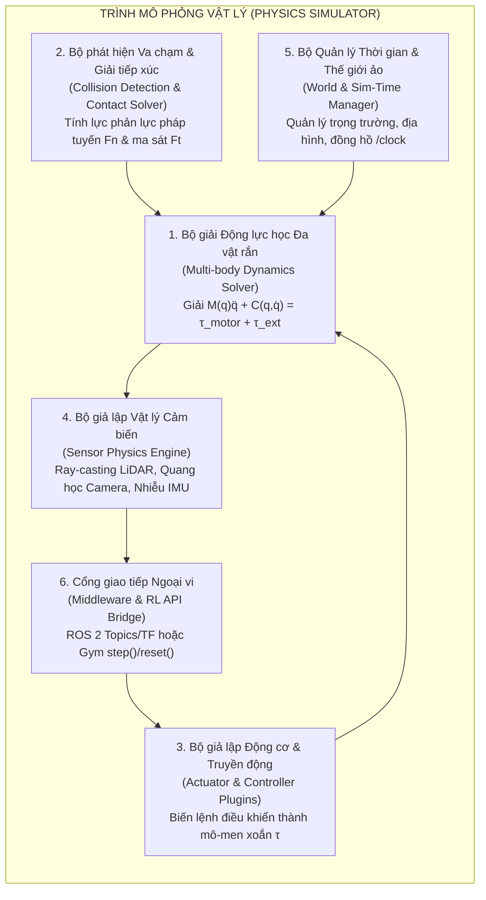
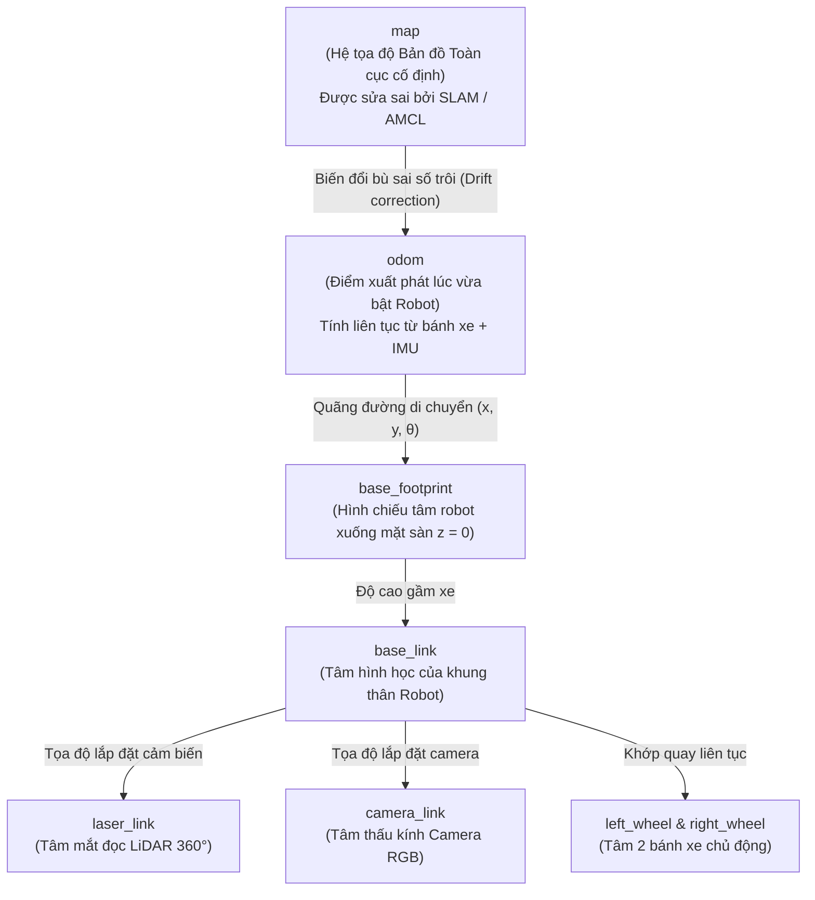

# HƯỚNG DẪN TOÀN DIỆN VỀ SIMULATION & CẤU HÌNH VẬT LÝ TRONG ROBOTICS VÀ REINFORCEMENT LEARNING

> **Mục tiêu tài liệu:** Tài liệu này cung cấp lộ trình học thực hành chi tiết cho phần **Simulation (Mô phỏng Robot)**, giải thích toàn bộ **năng lực cốt lõi của một trình mô phỏng (Simulator)**, hướng dẫn **cấu hình chi tiết từ Docker, URDF/SDF, Gazebo, Nav2 đến RL Simulator (MuJoCo/Isaac Lab)**, và đặc biệt là **chứng minh các thông số cấu hình trong code ánh xạ với các định luật Vật lý & Toán học ngoài đời thực như thế nào**.

---

## MỤC LỤC
0. [Kiến trúc Phân tầng 7 Lớp Sim-to-Real & Bộ Code Minh họa Thực thi (`Sim2Real_Robotics/`)](#0-kiến-trúc-phân-tầng-7-lớp-sim-to-real--bộ-code-minh-họa-thực-thi-sim2real_robotics)
1. [Trình mô phỏng (Simulator) thực chất làm được những gì?](#1-trình-mô-phỏng-simulator-thực-chất-làm-được-những-gì)
2. [Giải mã Cấu hình Vật lý: Từng dòng Cấu hình khớp với Định luật Vật lý ra sao?](#2-giải-mã-cấu-hình-vật-lý-từng-dòng-cấu-hình-khớp-với-định-luật-vật-lý-ra-sao)
   - [2.1. Khối lượng & Ma trận Quán tính (`<inertial>`) $\leftrightarrow$ Định luật Newton – Euler](#21-khối-lượng--ma-trận-quán-tính-inertial-leftrightarrow-định-luật-newton--euler)
   - [2.2. Khớp nối & Động cơ (`<joint>`, `<dynamics>`, `<limit>`) $\leftrightarrow$ Động lực học Cơ điện](#22-khớp-nối--động-cơ-joint-dynamics-limit-leftrightarrow-động-lực-học-cơ-điện)
   - [2.3. Va chạm & Ma sát bề mặt (`<collision>`, `<surface>`) $\leftrightarrow$ Cơ học Tiếp xúc](#23-va-chạm--ma-sát-bề-mặt-collision-surface-leftrightarrow-cơ-học-tiếp-xúc)
   - [2.4. Thời gian tích phân (`max_step_size`, `real_time_factor`) $\leftrightarrow$ Giải tích Số](#24-thời-gian-tích-phân-max_step_size-real_time_factor-leftrightarrow-giải-tích-số)
3. [Lộ trình Học & Thực hành Simulation (Theo khoá `robotics_essentials_ros2`)](#3-lộ-trình-học--thực-hành-simulation-theo-khoá-robotics_essentials_ros2)
   - [Giai đoạn 0: Cấu hình Hạ tầng Docker, X11 GUI & GPU](#giai-đoạn-0-cấu-hình-hạ-tầng-docker-x11-gui--gpu)
   - [Giai đoạn 1: Khởi chạy Gazebo, Hệ trục tọa độ TF & ROS 2 Topics](#giai-đoạn-1-khởi-chạy-gazebo-hệ-trục-tọa-độ-tf--ros-2-topics)
   - [Giai đoạn 2: SLAM (Lập bản đồ) & Điều hướng tự hành Nav2](#giai-đoạn-2-slam-lập-bản-đồ--điều-hướng-tự-hành-nav2)
   - [Giai đoạn 3 & 4: Động học Robot Vi sai & Tự tính Odometry từ Encoder](#giai-đoạn-3--4-động-học-robot-vi-sai--tự-tính-odometry-từ-encoder)
   - [Giai đoạn 5: Cấu hình Bản đồ Chi phí (Costmap) & Thuật toán Tìm đường (Path Planning)](#giai-đoạn-5-cấu-hình-bản-đồ-chi-phí-costmap--thuật-toán-tìm-đường-path-planning)
4. [Cấu hình Mô phỏng Chuyên dụng cho Huấn luyện RL (MuJoCo & Isaac Lab)](#4-cấu-hình-mô-phỏng-chuyên-dụng-cho-huấn-luyện-rl-mujoco--isaac-lab)
5. [Bảng Chẩn đoán Lỗi Vật lý Thường gặp khi Cấu hình Simulation](#5-bảng-chẩn-đoán-lỗi-vật-lý-thường-gặp-khi-cấu-hình-simulation)

---

## 0. Kiến trúc Phân tầng 7 Lớp Sim-to-Real & Bộ Code Minh họa Thực thi (`Sim2Real_Robotics/`)

Để giải quyết triệt để câu hỏi **"Làm sao kết nối từ Simulation Training ra Robot thực tế, và khi chỉ có code trên máy tính thì làm sao chứng minh được mô phỏng & thuật toán RL thực sự sống sót ngoài đời thực?"**, toàn bộ hệ thống đã được tách thành **5 phần chuyên sâu (tương ứng 7 tầng kiến trúc)** trong thư mục [Sim2Real_Robotics/](file:///home/thinh/Reinforcement-Learning/Sim2Real_Robotics/README.md):

| Tầng Kiến trúc | Tài liệu Lý thuyết & Toán-Lý (`.md`) | Code Minh họa Thực thi (`.py`) | Giải quyết Bài toán Cốt lõi nào? |
| :--- | :--- | :--- | :--- |
| **Tổng quan 7 Tầng** | [Sim2Real_Robotics/README.md](file:///home/thinh/Reinforcement-Learning/Sim2Real_Robotics/README.md) | — | Sơ đồ tổng thể kết nối từ Vật lý phần cứng $\to$ Bộ giải số $\to$ RL Training $\to$ Kiểm định Vật lý $\to$ ROS 2 & Robot thật. |
| **Tầng 1: Mô tả Cơ học & Phần cứng** | [Part1_Physical_Modeling_URDF_MJCF.md](file:///home/thinh/Reinforcement-Learning/Sim2Real_Robotics/Part1_Physical_Modeling_URDF_MJCF.md) | [01_urdf_physics_inspector.py](file:///home/thinh/Reinforcement-Learning/Sim2Real_Robotics/code/01_urdf_physics_inspector.py) | Kiểm định cấu hình `<inertial>` ($\mathbf{I} \succ 0$, bất đẳng thức tam giác $I_1+I_2\ge I_3$), đa giác chân đế chống lật $a_{\max}$, điều kiện ổn định CFL $\Delta t_{\max}$ và đường bao Torque-Speed động cơ DC. |
| **Tầng 2: Bộ giải Động lực học & Cảm biến** | [Part2_Physics_Engine_And_Sensors.md](file:///home/thinh/Reinforcement-Learning/Sim2Real_Robotics/Part2_Physics_Engine_And_Sensors.md) | [02_physics_engine_from_scratch.py](file:///home/thinh/Reinforcement-Learning/Sim2Real_Robotics/code/02_physics_engine_from_scratch.py) | Xây dựng Physics Engine từ gốc (Symplectic Euler vs. RK4), ma sát trượt bánh Coulomb-Stribeck (Wheel Slip), hàng đợi độ trễ phần cứng và cảm biến LiDAR Ray-casting, Encoder, IMU. |
| **Tầng 3: Môi trường RL, Hàm thưởng Vật lý & DR** | [Part3_RL_Training_Environment_And_Rewards.md](file:///home/thinh/Reinforcement-Learning/Sim2Real_Robotics/Part3_RL_Training_Environment_And_Rewards.md) | [03_train_rl_navigation_agent.py](file:///home/thinh/Reinforcement-Learning/Sim2Real_Robotics/code/03_train_rl_navigation_agent.py) | Thiết kế Observation hệ tọa độ thân xe `base_link`, bộ lọc thông thấp EMA, hàm thưởng phạt độ giật cơ khí (Jerk/Action Rate) + phạt nhiệt năng $\tau^2$, và huấn luyện với Domain Randomization. |
| **Tầng 4: Kiểm định Thực tế Vật lý Bằng Code** | [Part4_Code_Only_Physical_Verification.md](file:///home/thinh/Reinforcement-Learning/Sim2Real_Robotics/Part4_Code_Only_Physical_Verification.md) | [04_physical_reality_verification_suite.py](file:///home/thinh/Reinforcement-Learning/Sim2Real_Robotics/code/04_physical_reality_verification_suite.py) | **Bộ 7 Bài Kiểm Định Thực Tế Bằng Code:** Kiểm tra bảo toàn năng lượng, tải nhiệt RMS động cơ, phân tích phổ tần số Fourier (FFT Chattering), biên độ trễ $100\text{ ms}$, kiểm định chéo **Sim-to-Sim** (Euler $\to$ RK4) và suy giảm cảm biến. |
| **Tầng 5–6–7: Cầu nối ROS 2, Lá chắn An toàn & Robot Thật** | [Part5_ROS2_Gazebo_And_Real_Robot_Bridge.md](file:///home/thinh/Reinforcement-Learning/Sim2Real_Robotics/Part5_ROS2_Gazebo_And_Real_Robot_Bridge.md) | [05_ros2_rl_deployment_node.py](file:///home/thinh/Reinforcement-Learning/Sim2Real_Robotics/code/05_ros2_rl_deployment_node.py) | Chuyển đổi `/scan` (Min-Pooling) + `/odom` (Quaternion $\to$ Yaw) sang Policy, bọc qua **Hardware Safety Shield** (Slew-rate limiter + Emergency TTC Brake) và phát `/cmd_vel` điều khiển Gazebo hoặc Robot thật. |

---

## 1. Trình mô phỏng (Simulator) thực chất làm được những gì?

Nhiều người lầm tưởng trình mô phỏng (như **Gazebo**, **MuJoCo**, **Isaac Sim**) chỉ là phần mềm vẽ hình 3D chuyển động như phim hoạt hình. Thực chất, bên dưới giao diện đồ họa là một **Hệ thống Giải Phương trình Vi phân Vật lý Thời gian thực** gồm **6 trụ cột cốt lõi**:



### Chi tiết 6 khả năng của Trình mô phỏng:

1. **Giải bài toán Động lực học Thuận (Forward Dynamics):**
   - Tại mỗi bước thời gian $\Delta t$ (thường là $1\text{ ms} = 0.001\text{ s}$), simulator nhận vào **lực/mô-men xoắn** $\boldsymbol{\tau}$ của các động cơ và giải phương trình vi phân chuyển động tổng quát của hệ robot:
     $$\mathbf{M}(\mathbf{q})\ddot{\mathbf{q}} + \mathbf{C}(\mathbf{q}, \dot{\mathbf{q}})\dot{\mathbf{q}} + \mathbf{g}(\mathbf{q}) = \boldsymbol{\tau}_{\text{motor}} - \mathbf{b}(\dot{\mathbf{q}}) + \mathbf{J}^T(\mathbf{q})\mathbf{f}_{\text{contact}}$$
   - Từ đó tìm ra **gia tốc góc** $\ddot{\mathbf{q}}$, tích phân ra **vận tốc** $\dot{\mathbf{q}}$ và **vị trí mới** $\mathbf{q}$ của từng khớp, từng bánh xe.

2. **Phát hiện Va chạm Hình học & Giải lực Tiếp xúc (Collision & Contact Mechanics):**
   - Kiểm tra hàng nghìn lưới hình học (mesh/box/cylinder) xem bánh xe có chạm đất không, thân robot có đâm vào tường không.
   - Khi có va chạm, simulator tự động tính **phản lực pháp tuyến** $F_n$ (ngăn robot xuyên qua sàn nhà) và **lực ma sát tiếp tuyến** $F_t$ (giúp bánh xe bám đường để tiến về phía trước hoặc bị trượt nếu sàn trơn).

3. **Mô phỏng Vật lý của các Cảm biến (Sensor Physics Simulation):**
   - **LiDAR (Laser Scanner):** Không phải lấy tọa độ gian lận, mà thực sự bắn hàng trăm tia ảo (**Ray-casting**) ra không gian 3D theo góc $360^\circ$, tìm giao điểm gần nhất với mặt tường để tính khoảng cách $d$, rồi cộng thêm nhiễu trắng Gaussian $\epsilon \sim \mathcal{N}(0, \sigma^2)$ giống hệt mắt đọc quang học thật.
   - **Camera RGB & Depth (RGB-D):** Dùng thuật toán dựng hình quang học (Rasterization / Ray-tracing) qua mô hình máy ảnh lỗ kim (Pinhole Camera Model) với tiêu cự $f_x, f_y$, góc mở FOV để xuất ra ma trận điểm ảnh.
   - **IMU (Cảm biến quán tính):** Đọc trực tiếp đạo hàm vận tốc góc $\boldsymbol{\omega}$ và gia tốc tuyến tính $\mathbf{a} - \mathbf{g}$ tại vị trí gắn chip IMU trên khung robot, cộng thêm độ trôi (bias drift).
   - **Wheel Encoders:** Đếm góc quay tích lũy $\phi(t)$ và tốc độ góc $\dot{\phi}(t)$ của trục bánh xe.

4. **Giả lập Cơ cấu Chấp hành (Actuators & Low-level Controllers):**
   - Chuyển đổi các lệnh điều khiển cấp cao (như vận tốc mong muốn $v, \omega$ trong gói tin `/cmd_vel`) thành mô-men xoắn áp vào trục bánh xe thông qua các bộ điều khiển nội tại (như `DiffDrive` plugin hoặc bộ điều khiển PID khớp).

5. **Kiểm soát Thời gian Ảo (Virtual Time Control):**
   - Cho phép **tạm dừng (Pause)** thế giới để kiểm tra thông số, **tua chậm (Slow-motion)** để soi kỹ khoảnh khắc robot bị trượt ngã, hoặc **tua nhanh gấp hàng nghìn lần (Fast-forward / Headless)** khi huấn luyện AI/RL mà không bị ràng buộc bởi đồng hồ đời thực.

6. **Kiểm thử An toàn Không giới hạn (Zero-Cost Destructive Testing):**
   - Tạo ra địa hình gồ ghề, dốc nghiêng, chướng ngại vật di động, tắt/bật cảm biến đột ngột hoặc đặt lực đẩy ngoại cảnh để kiểm tra giới hạn chịu đựng của thuật toán điều khiển.

---

## 2. Giải mã Cấu hình Vật lý: Từng dòng Cấu hình khớp với Định luật Vật lý ra sao?

Trong cả **Gazebo (URDF / Xacro / SDF)** và **RL Simulators (MuJoCo MJCF)**, một con robot được định nghĩa bằng các khối cấu trúc **Links** (các khối vật rắn như khung xe, bánh xe) nối với nhau bởi **Joints** (các khớp xoay hoặc tịnh tiến).

Dưới đây là giải thích chi tiết từng khối cấu hình và phương trình vật lý đứng đằng sau nó.

---

### 2.1. Khối lượng & Ma trận Quán tính (`<inertial>`) $\leftrightarrow$ Định luật Newton – Euler

#### 📄 Đoạn cấu hình mẫu trong file URDF / SDF:
```xml
<link name="base_link">
  <inertial>
    <!-- Trọng tâm (Center of Mass - CoM) so với gốc của base_link -->
    <origin xyz="0.0 0.0 0.05" rpy="0 0 0"/>
    <!-- Khối lượng vật rắn (Đơn vị: kg) -->
    <mass value="2.5"/>
    <!-- Ma trận (Tensor) mô-men quán tính 3x3 đối xứng (Đơn vị: kg.m^2) -->
    <inertia ixx="0.015" ixy="0.0" ixz="0.0"
                         iyy="0.025" iyz="0.0"
                                     izz="0.035"/>
  </inertial>
</link>
```

#### 🔬 Bản chất Vật lý & Phương trình Toán học:

1. **Khối lượng (`mass value="m"`):**
   - Quy định quán tính **tịnh tiến** của vật theo Định luật II Newton:
     $$\mathbf{F} = m \cdot \mathbf{a} \implies \mathbf{a} = \frac{\mathbf{F}}{m}$$
   - **Ý nghĩa thực tế:** Nếu `mass` đặt quá nhỏ ($0.01\text{ kg}$), một lực đẩy nhẹ cũng làm robot bắn văng đi với gia tốc cực lớn. Nếu `mass` quá lớn ($100\text{ kg}$) mà `max_torque` của motor bánh xe giữ nguyên, robot sẽ không thể nhúc nhích khi lên dốc.

2. **Tâm khối / Trọng tâm (`origin xyz="x_c y_c z_c"`):**
   - Là điểm đặt của vector trọng lực $\mathbf{P} = m\mathbf{g}$.
   - **Ý nghĩa thực tế:** Trên robot 2 bánh ви sai (như robot **Andino**), nếu bạn cấu hình `z_c` quá cao (trọng tâm cao) hoặc lệch hẳn về phía không có bánh đỡ phụ (caster wheel), khi robot phanh gấp (gia tốc $a < 0$), mô-men quán tính $\tau_{\text{lật}} = m \cdot |a| \cdot z_c$ sẽ làm robot **chổng bánh lật nhào về phía trước** ngay trong mô phỏng!

3. **Tensor Quán tính (`ixx, iyy, izz, ixy, ixz, iyz`):**
   - Quy định sức ỳ khi vật **quay quanh các trục 3D** theo phương trình Euler cho vật rắn:
     $$\begin{bmatrix} \tau_x \\ \tau_y \\ \tau_z \end{bmatrix} = \underbrace{\begin{bmatrix} I_{xx} & I_{xy} & I_{xz} \\ I_{xy} & I_{yy} & I_{yz} \\ I_{xz} & I_{yz} & I_{zz} \end{bmatrix}}_{\mathbf{I} \text{ (Inertia Tensor)}} \begin{bmatrix} \alpha_x \\ \alpha_y \\ \alpha_z \end{bmatrix} + \boldsymbol{\omega} \times (\mathbf{I}\boldsymbol{\omega})$$
   - **Giải thích từng tham số:**
     - $I_{xx} = \int (y^2 + z^2)\,dm$: Sức ỳ khi robot **nghiêng trái/phải (Roll)** quanh trục $X$.
     - $I_{yy} = \int (x^2 + z^2)\,dm$: Sức ỳ khi robot **chúi đầu/ngửa cổ (Pitch)** quanh trục $Y$.
     - $I_{zz} = \int (x^2 + y^2)\,dm$: Sức ỳ khi robot **xoay hướng (Yaw)** quanh trục thẳng đứng $Z$ (Cực kỳ quan trọng khi robot xoay tại chỗ!).
     - $I_{xy}, I_{xz}, I_{yz}$: Các tích quán tính (Products of Inertia). Nếu vật thể đối xứng qua 3 mặt phẳng tọa độ thì $I_{xy} = I_{xz} = I_{yz} = 0$.

> 💡 **Công thức chuẩn để tính nhanh `<inertia>` khi tự cấu hình Robot:**
> - **Khối hộp chữ nhật (Thân robot)** kích thước $(w, d, h)$, khối lượng $m$:
>   $$I_{xx} = \frac{1}{12}m(d^2 + h^2), \quad I_{yy} = \frac{1}{12}m(w^2 + h^2), \quad I_{zz} = \frac{1}{12}m(w^2 + d^2)$$
> - **Hình trụ đặc (Bánh xe)** bán kính $r$, bề dày $t$, khối lượng $m$ (trục quay là trục $Z$):
>   $$I_{xx} = I_{yy} = \frac{1}{12}m(3r^2 + t^2), \quad I_{zz} = \frac{1}{2}mr^2$$
> - **Hình cầu đặc (Bánh tự lựa - Caster wheel)** bán kính $r$, khối lượng $m$:
>   $$I_{xx} = I_{yy} = I_{zz} = \frac{2}{5}mr^2$$
>
> ⚠️ **Lưu ý sống còn:** Không bao giờ được gán `ixx="0" iyy="0" izz="0"`! Khi giải phương trình $\boldsymbol{\alpha} = \mathbf{I}^{-1}\boldsymbol{\tau}$, việc chia cho $0$ sẽ tạo ra gia tốc góc $\infty$ (`NaN`), khiến robot biến mất hoặc nổ tung ngay khi vừa bấm Play.

---

### 2.2. Khớp nối & Động cơ (`<joint>`, `<dynamics>`, `<limit>`) $\leftrightarrow$ Động lực học Cơ điện

#### 📄 Đoạn cấu hình mẫu:
```xml
<joint name="left_wheel_joint" type="continuous">
  <parent link="base_link"/>
  <child link="left_wheel"/>
  <!-- Vị trí đặt trục bánh xe so với base_link (y = +0.0685m tức cách tâm 6.85cm) -->
  <origin xyz="0.0 0.0685 0.0" rpy="-1.5708 0 0"/>
  <!-- Vector đơn vị chỉ hướng trục quay -->
  <axis xyz="0 0 1"/>
  <!-- Đặc tính ma sát nội tại của ổ bi và hộp số -->
  <dynamics damping="0.05" friction="0.02"/>
  <!-- Giới hạn vật lý của động cơ điện -->
  <limit effort="2.0" velocity="15.0"/>
</joint>
```

#### 🔬 Bản chất Vật lý & Phương trình Toán học:

Phương trình mô-men xoắn thực tế truyền ra trục khớp là:
$$\tau_{\text{net}} = \text{clip}\Big(\tau_{\text{cmd}}, -\tau_{\max}, +\tau_{\max}\Big) - \underbrace{b \cdot \dot{q}}_{\text{Damping}} - \underbrace{\tau_c \cdot \operatorname{sgn}(\dot{q})}_{\text{Coulomb Friction}}$$

1. **`type="continuous"` vs `type="revolute"`:**
   - `continuous`: Khớp quay tròn không có điểm dừng $\theta \in (-\infty, +\infty)$ (dùng cho bánh xe).
   - `revolute`: Khớp bản lề bị chặn bởi góc tối thiểu và tối đa $\theta \in [\text{lower}, \text{upper}]$ (dùng cho khớp khuỷu tay robot, khớp chân chó robot).
   - `prismatic`: Khớp trượt tịnh tiến (dùng cho xi-lanh thủy lực, thang nâng).

2. **`dynamics damping="b"` (Đơn vị: $\text{N}\cdot\text{m}\cdot\text{s/rad}$):**
   - Là **ma sát nhớt (Viscous Damping)** sinh ra bởi dầu bôi trơn trong hộp số và lực cản điện từ trong động cơ, tỷ lệ thuận với vận tốc góc: $\tau_{\text{damping}} = -b \cdot \dot{q}$.
   - **Tác dụng vật lý:** Tiêu tán năng lượng dư thừa, giúp bánh xe hoặc cánh tay robot **tự giảm tốc và dừng lại êm ái** khi ngắt điện, đồng thời chống dao động tự kích (oscillation).

3. **`dynamics friction="τ_c"` (Đơn vị: $\text{N}\cdot\text{m}$):**
   - Là **ma sát khô tĩnh (Coulomb Static Friction)** giữa các bánh răng cơ khí. Nếu mô-men động cơ $\tau_{\text{cmd}} < \tau_c$, trục khớp sẽ đứng im không nhúc nhích (vùng chết / deadzone của motor thật).

4. **`limit effort="τ_max"` (Đơn vị: $\text{N}\cdot\text{m}$) và `velocity="ω_max"` (Đơn vị: $\text{rad/s}$):**
   - `effort`: Mô-men xoắn cực đại của động cơ (do giới hạn dòng điện định mức $I_{\max}$ qua hằng số mô-men $\tau = K_t \cdot I$).
   - `velocity`: Tốc độ quay tối đa không tải của động cơ (do giới hạn điện áp nguồn $V_{\text{supply}}$ và sức phản điện động Back-EMF $V_{\text{bemf}} = K_e \cdot \omega$).

---

### 2.3. Va chạm & Ma sát bề mặt (`<collision>`, `<surface>`) $\leftrightarrow$ Cơ học Tiếp xúc

Trong mô phỏng, mỗi bộ phận của robot có **2 lớp vỏ độc lập**:
- **`<visual>`:** Lớp vỏ đồ họa (chỉ để mắt người và Camera nhìn thấy, có màu sắc, vân bề mặt phức tạp, **không có tính năng va chạm**).
- **`<collision>`:** Lớp vỏ vật lý (thường được tối giản thành hình trụ, hình hộp đơn giản để CPU/GPU tính toán va chạm cực nhanh).

#### 📄 Đoạn cấu hình tiếp xúc bánh xe trong Gazebo:
```xml
<gazebo reference="left_wheel">
  <mu1>1.0</mu1>
  <mu2>1.0</mu2>
  <kp>1000000.0</kp>
  <kd>100.0</kd>
  <minDepth>0.001</minDepth>
</gazebo>
```

#### 🔬 Bản chất Vật lý & Phương trình Toán học:

Khi bánh xe chạm mặt sàn, trình mô phỏng giải bài toán tiếp xúc qua 2 thành phần lực vuông góc nhau:

```
          ↑ Lực phản lực pháp tuyến Fn (Chống lún xuyên sàn - phụ thuộc kp, kd)
          │
     ┌────┴────┐
     │ Bánh xe │ ───► Chiều lăn tới
     └────┬────┘
    ◄─────•═════► Lực ma sát bám đường Ft (Giúp xe tiến tới - phụ thuộc mu1, mu2)
  Mặt sàn vật lý
```

1. **Độ cứng và Giảm chấn bề mặt (`kp` và `kd` — Mô hình Lò xo - Giảm chấn Kelvin-Voigt):**
   - Trong máy tính, các vật rắn tiếp xúc nhau bằng cách lún nhẹ vào nhau một khoảng cực nhỏ $\delta$ (penetration depth). Phản lực pháp tuyến $F_n$ đẩy hai vật ra được tính bằng:
     $$F_n = k_p \cdot \delta - k_d \cdot \dot{\delta}$$
   - **`kp` (Contact Stiffness - Độ cứng tiếp xúc, $\text{N/m}$):**
     - `kp` lớn ($10^6 - 10^8$): Bề mặt cứng như thép/bê tông.
     - `kp` nhỏ ($10^3 - 10^4$): Bề mặt mềm, lún như đệm mút hoặc lốp bơm non hơi.
   - **`kd` (Contact Damping - Giảm chấn tiếp xúc, $\text{N}\cdot\text{s/m}$):**
     - Hấp thụ động năng khi va đập. Nếu `kd = 0`, bánh xe rơi xuống đất sẽ **nảy tưng tưng mãi không dừng** như quả bóng bàn!

2. **Hệ số Ma sát Coulomb theo 2 phương (`mu1` $\mu_1$ và `mu2` $\mu_2$):**
   - Theo định luật ma sát Coulomb, lực bám tối đa song song với mặt sàn bị giới hạn bởi áp lực pháp tuyến:
     $$|F_{t, 1}| \le \mu_1 F_n, \quad |F_{t, 2}| \le \mu_2 F_n$$
   - `mu1`: Hệ số ma sát dọc theo chiều lăn của bánh xe.
   - `mu2`: Hệ số ma sát ngang (vuông góc với bánh xe, chống trượt ngang khi ôm cua).
   - **Ứng dụng thực tế cực hay trong cấu hình Robot:**
     - **Bánh chủ động (Left/Right Drive Wheels):** Đặt `mu1 = 1.0`, `mu2 = 1.0` (mô phỏng lốp cao su bám chặt mặt sàn để tạo lực đẩy).
     - **Bánh tự lựa (Caster Wheel):** Thay vì phải mô phỏng khớp xoay phức tạp của bánh xe phụ, kỹ sư thường gắn cố định một quả cầu và đặt **`mu1 = 0.001`, `mu2 = 0.001`** (trơn như nước đá) để nó trượt tự do trên sàn mà không gây lực cản làm lệch hướng xe!

---

### 2.4. Thời gian tích phân (`max_step_size`, `real_time_factor`) $\leftrightarrow$ Giải tích Số

#### 📄 Đoạn cấu hình trong file Thế giới (`world.sdf`):
```xml
<physics name="default_physics" type="ode">
  <!-- Bước nhảy thời gian tích phân vi phân Δt = 1ms (1000 Hz) -->
  <max_step_size>0.001</max_step_size>
  <!-- Số bước tính toán vật lý mong muốn trong 1 giây đời thực -->
  <real_time_update_rate>1000.0</real_time_update_rate>
</physics>
```

#### 🔬 Bản chất Vật lý & Phương trình Toán học:

Máy tính không thể tính thời gian liên tục mà phải rời rạc hóa theo từng lát cắt $\Delta t = \text{max\_step\_size}$ bằng phương pháp tích phân **Semi-Implicit Euler**:
$$\begin{aligned}
\mathbf{v}_{k+1} &= \mathbf{v}_k + \mathbf{a}_k \cdot \Delta t \\
\mathbf{x}_{k+1} &= \mathbf{x}_k + \mathbf{v}_{k+1} \cdot \Delta t
\end{aligned}$$

- **Mối quan hệ giữa các tham số thời gian:**
  $$\text{Target Real-Time Factor (RTF)} = \text{max\_step\_size} \times \text{real\_time\_update\_rate}$$
  - Với $\Delta t = 0.001\text{ s}$ và $\text{rate} = 1000\text{ Hz}$: $\text{RTF} = 0.001 \times 1000 = 1.0\times$ (1 giây mô phỏng = 1 giây đời thực).
  - **Nếu muốn chạy nhanh tối đa (dùng cho huấn luyện RL):** Đặt `<real_time_update_rate>0</real_time_update_rate>`. Khi đó CPU sẽ giải các bước $\Delta t = 0.001\text{ s}$ nhanh hết mức có thể mà không ngủ chờ đồng hồ thực!
- **Tại sao không được tăng `max_step_size` lên quá lớn (ví dụ $\Delta t = 0.1\text{ s}$)?**
  1. **Lỗi xuyên thấu hình học (Tunneling Effect):** Nếu robot chạy với vận tốc $2\text{ m/s}$, trong $\Delta t = 0.1\text{ s}$ nó nhảy một bước dài $20\text{ cm}$ — nhảy xuyên qua bức tường dày $10\text{ cm}$ mà bộ phát hiện va chạm chưa kịp thấy!
  2. **Mất ổn định số (Numerical Explosion):** Theo điều kiện ổn định Courant–Friedrichs–Lewy (CFL) cho hệ lò xo va chạm có độ cứng $k_p$:
     $$\Delta t < \frac{2}{\sqrt{k_p / m}}$$
     Nếu $\Delta t$ vượt ngưỡng này, lực đàn hồi $F_n = k_p \delta$ ở bước sau lớn gấp bội bước trước, làm năng lượng hệ thống tăng theo cấp số nhân và **bắn tung robot lên không trung**.

---

## 3. Lộ trình Học & Thực hành Simulation (Theo khoá `robotics_essentials_ros2`)

Dựa trên bộ mã nguồn thực hành bạn đang có tại [robotics_essentials_ros2](file:///home/thinh/Data/robotics_essentials_ros2), dưới đây là hướng dẫn học từng bước từ con số 0 đến làm chủ hệ thống.

---

### Giai đoạn 0: Cấu hình Hạ tầng Docker, X11 GUI & GPU

Các file cấu hình nằm tại:
- [Dockerfile](file:///home/thinh/Data/robotics_essentials_ros2/docker/Dockerfile)
- [docker-compose.yaml](file:///home/thinh/Data/robotics_essentials_ros2/docker/docker-compose.yaml)

#### Giải thích các tham số cấu hình quan trọng trong `docker-compose.yaml`:
| Dòng cấu hình | Giải thích kỹ thuật (Tại sao phải có?) |
| :--- | :--- |
| `network_mode: host` | Cho phép mạng DDS của ROS 2 bên trong Docker chia sẻ chung card mạng với máy chủ Linux. Giúp truyền dữ liệu hình ảnh Camera/LiDAR băng thông lớn mà không bị nghẽn qua NAT bridge. |
| `volumes: - /tmp/.X11-unix:/tmp/.X11-unix` & `environment: - DISPLAY` | **Cầu nối đồ họa X11:** Vì Docker container vốn không có màn hình, cấu hình này chuyển luồng vẽ cửa sổ 3D của Gazebo và RViz từ trong container ra thẳng màn hình Desktop của bạn. |
| `QT_X11_NO_MITSHM=1` | Tắt bộ nhớ chia sẻ MIT-SHM của thư viện giao diện Qt để tránh lỗi sập cửa sổ (crash đen màn hình) khi mở Gazebo/RViz qua Docker. |
| `ROS_DOMAIN_ID=42` | Tần số kênh liên lạc DDS (từ 0 đến 101). Chỉ các Node có cùng `ROS_DOMAIN_ID` mới nhìn thấy topic của nhau (tránh nhiễu khi nhiều robot chạy chung 1 mạng Wi-Fi). |
| `volumes: - $HOME/exercises_ws/src:/home/user/exercises_ws/src` | **Gắn kết thư mục (Bind Mount):** Mọi code Python bạn viết ngoài máy thật tại `/home/thinh/exercises_ws/src` sẽ lập tức xuất hiện bên trong container mà không sợ mất code khi tắt Docker. |

#### 🚀 Lệnh khởi chạy chuẩn:
```bash
# 1. Cho phép Docker truy cập X11 server để hiển thị giao diện Gazebo/RViz
xhost +local:docker

# 2. Di chuyển vào thư mục docker và bật container chạy ngầm
cd /home/thinh/Data/robotics_essentials_ros2/docker
docker compose up -d

# 3. Truy cập vào bên trong môi trường ảo của Robot
docker exec -it robotics_essentials_ros2 bash
```
*(Nếu máy bạn dùng GPU rời NVIDIA và thấy Gazebo bị giật khung hình, hãy mở file [docker-compose.yaml](file:///home/thinh/Data/robotics_essentials_ros2/docker/docker-compose.yaml#L12-L22) và bỏ dấu `#` ở dòng `runtime: nvidia` cùng 4 dòng `NVIDIA_...`).*

---

### Giai đoạn 1: Khởi chạy Gazebo, Hệ trục tọa độ TF & ROS 2 Topics
📖 **Tài liệu gốc:** [1-ros_2_introduction/README.md](file:///home/thinh/Data/robotics_essentials_ros2/1-ros_2_introduction/README.md)

#### 1. Khởi chạy mô phỏng Robot Andino:
Bên trong terminal của Docker, chạy lệnh:
```bash
ros2 launch andino_gz andino_gz.launch.py
```
Lệnh này đồng thời kích hoạt **4 tiến trình nền tảng**:
1. **Gazebo Server (`ign gazebo -s`):** Tính toán vật lý cho robot Andino và căn phòng.
2. **Gazebo GUI (`ign gazebo -g`):** Giao diện 3D để nhìn thế giới thật (World View).
3. **`ros_gz_bridge`:** Cầu nối dịch các tín hiệu nội bộ của Gazebo sang chuẩn gói tin ROS 2 (`/scan`, `/odom`, `/cmd_vel`, `/image_raw`, `/clock`).
4. **RViz2:** Giao diện hiển thị **Thế giới qua con mắt của Robot** (nơi chỉ hiển thị những gì cảm biến đo được).

> 💡 **Phân biệt cực kỳ quan trọng: Gazebo vs. RViz**
> - **Gazebo = Thế giới Vật lý Khách quan (Ground Truth):** Chứa tường gạch, bàn ghế, trọng lực, ma sát. Nếu robot bị che mắt, Gazebo vẫn biết bức tường nằm ở đâu.
> - **RViz = Não bộ的主quan của Robot (Perception View):** Robot chỉ biết những gì cảm biến của nó gửi về. Nếu tắt LiDAR và Camera, màn hình RViz sẽ trống trơn dù trong Gazebo có 10 bức tường trước mặt!

#### 2. Làm chủ Cây Hệ trục Tọa độ (TF Tree - Coordinate Transformations):
Trong một con robot, mỗi bộ phận đều gắn một hệ trục tọa độ $(X, Y, Z)$ riêng (theo quy tắc bàn tay phải của ROS: **$X$ hướng tới trước (Đỏ), $Y$ hướng sang trái (Xanh lá), $Z$ hướng thẳng lên trời (Xanh dương)**):



- **Tại sao phải chia làm cả `map` lẫn `odom`?**
  - Hệ `odom` được tính bằng cách cộng dồn vòng quay bánh xe: Rất mượt và không bao giờ bị nhảy cóc (liên tục theo thời gian), nhưng đi được 10 mét thì bánh xe bị trượt nhẹ làm lệch mất 20 cm (**Odometry Drift**).
  - Hệ `map` dùng cảm biến LiDAR so khớp với tường nhà (SLAM/AMCL) để biết vị trí chính xác tuyệt đối, nhưng tính toán chậm và thỉnh thoảng bị "nhảy vị trí" khi phát hiện lại góc tường quen thuộc.
  - Vì vậy: **Bộ điều khiển bánh xe (Local Controller)** nhìn vào `odom` để lái mượt, còn **Bộ tìm đường dài hạn (Global Planner)** nhìn vào `map` để đi đúng phòng!

---

### Giai đoạn 2: SLAM (Lập bản đồ) & Điều hướng tự hành Nav2
📖 **Tài liệu gốc:** [2-slam_and_navigation_demo/README.md](file:///home/thinh/Data/robotics_essentials_ros2/2-slam_and_navigation_demo/README.md)

1. **Thực hành SLAM (`slam_toolbox`):**
   ```bash
   ros2 launch andino_gz andino_gz.launch.py slam:=True
   ```
   - Khi bạn lái robot quanh phòng trong Gazebo, cảm biến LiDAR bắn tia laser vào tường và gửi mảng khoảng cách về topic `/scan`.
   - Thuật toán SLAM kết hợp vị trí tương đối từ `/odom` và tia quét `/scan` để tô màu lên lưới ô vuông 2D (**Occupancy Grid Map**):
     - Ô giá trị `0` (Trắng): Không gian trống (Free space) — tia laser đi xuyên qua.
     - Ô giá trị `100` (Đen): Vật cản/Tường (Occupied) — điểm tia laser bị phản xạ lại.
     - Ô giá trị `-1` (Xám): Chưa từng quét tới (Unknown).

2. **Thực hành Điều hướng Tự hành (`Nav2`):**
   ```bash
   ros2 launch andino_gz andino_gz.launch.py nav2:=True
   ```
   - **Bước 1 (`2D Pose Estimate`):** Chỉ cho thuật toán định vị hạt **AMCL (Adaptive Monte Carlo Localization)** biết robot đang đứng ở đâu trên bản đồ.
   - **Bước 2 (`Nav2 Goal`):** Chọn điểm đích, Nav2 sẽ tự động lập đường đi và xuất vận tốc `/cmd_vel` lái robot né mọi chướng ngại vật tới đích.

---

### Giai đoạn 3 & 4: Động học Robot Vi sai & Tự tính Odometry từ Encoder
📖 **Tài liệu gốc:** [3-create_ros_2_package/README.md](file:///home/thinh/Data/robotics_essentials_ros2/3-create_ros_2_package/README.md) & [4-robot_odometry/README.md](file:///home/thinh/Data/robotics_essentials_ros2/4-robot_odometry/README.md)

Đây là bài tập quan trọng nhất để hiểu **sự kết nối giữa Kích thước Hình học trong Mô phỏng và Toán học Điều khiển**.

#### 📐 Chứng minh Toán học & Vật lý của Robot 2 bánh Vi sai (Differential Drive):

```
               ╭───────────╮
               │ Bánh Trái │ ──► Vận tốc dài v_L = r * ω_L
               ╰───────────╯
                     ▲
                     │ Khoảng cách 2 bánh: L (wheel_separation = 0.137 m)
                     │         
                     • ────────► Vận tốc tâm Robot: v = (v_R + v_L) / 2
                     │         ↺ Vận tốc xoay:      ω = (v_R - v_L) / L
                     ▼
               ╭───────────╮
               │ Bánh Phải │ ──► Vận tốc dài v_R = r * ω_R
               ╰───────────╯
         (Bán kính bánh xe: r = wheel_radius = 0.033 m)
```

1. **Từ tốc độ góc trục bánh xe sang vận tốc dài từng bánh:**
   Trình mô phỏng Gazebo xuất tốc độ quay của khớp bánh trái $\omega_L$ và bánh phải $\omega_R$ (đơn vị: $\text{rad/s}$) qua topic `/joint_states`. Với bán kính bánh xe $r = 0.033\text{ m}$ (`self.wheel_radius`), vận tốc dài tại điểm tiếp đất của mỗi bánh (giả sử lăn không trượt) là:
   $$v_L = r \cdot \omega_L, \qquad v_R = r \cdot \omega_R$$

2. **Tổng hợp vận tốc tại tâm Robot (`base_link`):**
   - Vận tốc tiến thẳng $v$ (Linear velocity) là trung bình cộng của 2 bánh:
     $$v = \frac{v_R + v_L}{2}$$
   - Vận tốc quay quanh trục $Z$ là $\omega$ (Angular velocity) sinh ra do sự chênh lệch tốc độ giữa bánh phải và bánh trái chia cho khoảng cách hai bánh $L = 0.137\text{ m}$ (`self.wheel_separation`):
     $$\omega = \frac{v_R - v_L}{L}$$
   *(Kiểm chứng trực giác: Nếu $v_R = v_L \implies \omega = 0$, xe đi thẳng. Nếu $v_R = -v_L \implies v = 0$, xe xoay tròn tại chỗ!)*

3. **Tích phân Euler theo bước thời gian $\Delta t$ để tìm tọa độ $(x, y, \theta)$:**
   $$\begin{aligned}
   \Delta x &= v \cdot \cos(\theta_t) \cdot \Delta t \\
   \Delta y &= v \cdot \sin(\theta_t) \cdot \Delta t \\
   \Delta \theta &= \omega \cdot \Delta t
   \end{aligned}
   \implies
   \begin{cases}
   x_{t+1} = x_t + \Delta x \\
   y_{t+1} = y_t + \Delta y \\
   \theta_{t+1} = \theta_t + \Delta \theta
   \end{cases}$$

> ⚠️ **Tại sao khi chạy Node Odometry bắt buộc phải truyền `--ros-args -p use_sim_time:=True`?**
> Trong dòng code `self.get_clock().now()`, nếu không bật `use_sim_time:=True`, code Python sẽ lấy **giờ đồng hồ treo tường của máy tính (Wall Time)**, trong khi vận tốc bánh xe lại chạy theo **giờ vật lý của Gazebo (`/clock`)**. Nếu máy tính của bạn hơi lag làm Gazebo chỉ chạy được ở tốc độ $0.5\times$ ($\text{RTF} = 0.5$), thì $\Delta t$ tính theo giờ máy tính sẽ bị **gấp đôi** thực tế, làm quãng đường Odometry tính ra bị phóng đại gấp 2 lần!

---

### Giai đoạn 5: Cấu hình Bản đồ Chi phí (Costmap) & Thuật toán Tìm đường (Path Planning)
📖 **Tài liệu gốc:** [5-path_planning/README.md](file:///home/thinh/Data/robotics_essentials_ros2/5-path_planning/README.md)

Trong Nav2, robot không nhìn bản đồ dưới dạng trắng/đen đơn thuần, mà biến đổi thành **Costmap (Bản đồ chi phí)** thông qua file cấu hình `nav2_params.yaml`.

#### Giải mã cấu hình Vật lý trong `nav2_params.yaml`:

```yaml
local_costmap:
  local_costmap:
    ros__parameters:
      robot_radius: 0.12          # Bán kính đường tròn bao quanh thân robot (12 cm)
      inflation_layer:
        plugin: "nav2_costmap_2d::InflationLayer"
        cost_scaling_factor: 3.0  # Độ dốc giảm dần của vùng nguy hiểm quanh vật cản
        inflation_radius: 0.35    # Bán kính vùng đệm an toàn quanh tường (35 cm)
```

```
Giá trị Chi phí (Cost: 0 -> 254)
  254 (Lethal - Đâm tường chắc chắn)  │█████
  253 (Inscribed - Chạm mép vỏ robot) │█████▓▓▓▓▓
  128 (Vùng đệm nguy hiểm giảm dần)   │█████▓▓▓▓▓▒▒▒▒▒░░░░░
    0 (Không gian an toàn tuyệt đối)  │█████▓▓▓▓▓▒▒▒▒▒░░░░░________________
                                      └─────┴────┴─────────┴──────────────► Khoảng cách tới tường d
                                      0   r_robot (0.12m)  r_inflation (0.35m)
```

- **`robot_radius: 0.12` (m):** Trên bản đồ số, robot được coi như 1 điểm chất điểm $(x, y)$. Để thân robot thật (rộng $24\text{ cm}$) không quệt vào tường, Nav2 "thổi phồng" mọi bức tường dày thêm một khoảng đúng bằng bán kính robot $R_{\text{robot}} = 0.12\text{ m}$ (vùng **Inscribed Obstacle** có cost = 253). Nếu tâm robot đi vào vùng này, vỏ robot chắc chắn va chạm với tường!
- **`inflation_radius: 0.35` (m) & `cost_scaling_factor` ($k$):** Tạo một lớp đệm chi phí giảm theo hàm mũ quanh vật cản:
  $$\text{Cost}(d) = \exp\Big(-k \cdot (d - R_{\text{robot}})\Big) \times 252$$
  - `cost_scaling_factor` càng nhỏ $\to$ vùng đệm phình to, ép robot luôn đi chính giữa hành lang, cách xa hai bên tường.
  - `cost_scaling_factor` càng lớn $\to$ chi phí giảm dốc đứng sát tường, cho phép robot lách sát qua các khe cửa hẹp.

---

## 4. Cấu hình Mô phỏng Chuyên dụng cho Huấn luyện RL (MuJoCo & Isaac Lab)

Khi bạn chuyển từ điều khiển cổ điển (ROS 2 / Gazebo) sang huấn luyện **Reinforcement Learning** (như **PPO ở [Week 5](file:///home/thinh/Reinforcement-Learning/Week5/BAI_GIANG.md)**, **Model-Based MPC ở [Week 7](file:///home/thinh/Reinforcement-Learning/Week7/BAI_GIANG.md)**, hay **SAC ở [Week 8](file:///home/thinh/Reinforcement-Learning/Week8/BAI_GIANG.md)**), cấu hình mô phỏng có thêm 3 khái niệm đặc thù:

### 4.1. Tần số Vật lý vs. Tần số Chính sách (`sim_dt` & `decimation`)
Trong RL (như MuJoCo hoặc NVIDIA Isaac Lab), mạng nơ-ron Policy không ra quyết định ở mọi bước vật lý, mà dùng cơ chế **Decimation (Frame-skip vật lý)**:

```python
# Cấu hình chuẩn trong NVIDIA Isaac Lab / MuJoCo Env:
sim_dt = 0.002        # Bước tích phân vật lý: 2 ms (500 Hz)
decimation = 10       # Giữ nguyên lệnh của mạng RL trong 10 bước vật lý
control_dt = sim_dt * decimation  # Tần số ra quyết định của RL Policy: 20 ms (50 Hz)
```

- **Tại sao phải làm vậy?**
  - **Vật lý (`500 Hz`):** Giải va chạm và điều khiển dòng điện motor cần tần số rất cao ($500 - 1000\text{ Hz}$) để hệ cơ học ổn định.
  - **Mạng nơ-ron RL (`50 Hz`):** Nếu bắt Policy xuất hành động ở $1000\text{ Hz}$, sự thay đổi quá nhỏ giữa 2ms làm chân robot chỉ rung nhẹ tại chỗ (giống hệt lý do phải dùng `FrameSkip=4` trong Atari DQN ở [Week 3](file:///home/thinh/Reinforcement-Learning/Week3/BAI_GIANG.md)). Chạy Policy ở $50\text{ Hz}$ vừa tiết kiệm $10\times$ thời gian tính toán GPU, vừa khớp với tốc độ truyền tin thực tế trên phần cứng robot.

### 4.2. Bộ điều khiển Khớp Nội tại (`stiffness` $K_p$ & `damping` $K_d$)
Hầu hết các thuật toán RL cho robot bốn chân/hình người hiện nay **không xuất trực tiếp mô-men xoắn $\tau$**, mà mạng nơ-ron xuất ra **Góc khớp mục tiêu $q_{\text{target}}$**, sau đó trình mô phỏng dùng bộ điều khiển **PD (Proportional-Derivative)** tốc độ cao để tính ra lực:
$$\tau = K_p \cdot \big(q_{\text{target}} - q\big) - K_d \cdot \dot{q}$$
- Cấu hình `stiffness` ($K_p$): Giống như độ cứng của cơ bắp. $K_p$ quá nhỏ làm chân robot mềm nhũn, khuỵu gối dưới sức nặng cơ thể; $K_p$ quá lớn làm chân robot giật cục, cứng đờ.
- Cấu hình `damping` ($K_d$): Giảm chấn chống rung khớp.

### 4.3. Cấu hình Domain Randomization (Chìa khóa để mang từ Sim ra Robot thật)
Bảng cấu hình ngẫu nhiên hóa thông số vật lý chuẩn công nghiệp khi huấn luyện RL:

| Tham số vật lý trong Simulator | Dải ngẫu nhiên hóa (Randomization Range) | Mục đích thực tế (Chống lỗi gì ngoài đời thực?) |
| :--- | :--- | :--- |
| **Hệ số ma sát mặt sàn ($\mu$)** | $\mathcal{U}(0.3, 1.25)$ | Giúp robot đi được cả trên sàn gạch trơn bóng lẫn thảm nhám hay đường nhựa. |
| **Khối lượng thân chính ($m$)** | $+ \mathcal{U}(-1.0, +3.0)\text{ kg}$ | Giúp robot vẫn đi vững khi cõng thêm pin dự phòng, gắn thêm cảm biến hoặc mang hàng. |
| **Tâm trọng lực ($\text{CoM}_{xyz}$)** | $+ \mathcal{U}(-0.05, +0.05)\text{ m}$ | Bù trừ sai số lắp ráp cơ khí và vị trí đặt dây điện bên trong vỏ máy. |
| **Độ mạnh động cơ ($K_p, K_d, \tau$)** | $\times \mathcal{U}(0.85, 1.15)$ | Bù trừ hiện tượng motor bị yếu đi khi nóng hoặc khi pin sắp cạn. |
| **Độ trễ tín hiệu (Action Delay)** | $\mathcal{U}(0, 20)\text{ ms}$ | Bù trừ độ trễ truyền gói tin qua cáp USB/CAN/ROS 2 giữa máy tính và mạch motor. |
| **Nhiễu cảm biến (Observation Noise)** | $+ \mathcal{N}(0, \sigma^2)$ | Giúp mạng nơ-ron không bị hoảng loạn trước nhiễu rung của cảm biến IMU và Encoder thật. |

---

## 5. Bảng Chẩn đoán Lỗi Vật lý Thường gặp khi Cấu hình Simulation

Khi làm việc với Gazebo, MuJoCo hoặc Isaac Gym, nếu thấy robot có biểu hiện kỳ lạ, hãy tra bảng chẩn đoán dưới đây:

| Hiện tượng quan sát được trong Simulator | Nguyên nhân Vật lý / Cấu hình sai | Cách khắc phục triệt để |
| :--- | :--- | :--- |
| **Robot vừa xuất hiện đã bay vút lên trời hoặc biến mất ( lỗi `NaN` )** | 1. Đặt `<mass>` hoặc `<inertia>` bằng $0$ (chia cho 0 khi tính $\mathbf{I}^{-1}$).<br>2. Hai khối `<collision>` bị đặt đè xuyên vào nhau ngay lúc khởi tạo, sinh ra lực đẩy đàn hồi $F_n = k_p \delta$ khổng lồ. | 1. Kiểm tra mọi link đều có `mass > 0` và `ixx, iyy, izz > 0`.<br>2. Tách khoảng cách `<origin>` hoặc tắt va chạm giữa 2 link kề nhau (`disable_collisions`). |
| **Bánh xe quay tít nhưng Robot đứng yên tại chỗ hoặc lết đi rất chậm** | 1. Hệ số ma sát `mu1`, `mu2` của bánh xe quá nhỏ.<br>2. Bánh xe bị gắn hơi cao hơn mặt sàn (chưa chạm đất) do lệch `<origin xyz>` của bánh tự lựa (caster wheel). | 1. Tăng `mu1 = 1.0`, `mu2 = 1.0` cho 2 bánh chủ động.<br>2. Bật chế độ hiển thị `View -> Collisions` và `View -> Contacts` trong Gazebo để xem các điểm chấm xanh tiếp đất có nằm đều trên cả bánh chính và bánh phụ không. |
| **Robot đứng yên nhưng thân xe cứ tự rung lắc (Jittering / Shaking) liên tục** | 1. Bước thời gian `max_step_size` quá lớn so với độ cứng tiếp xúc `kp`.<br>2. Hệ số `K_p` của bộ điều khiển PID khớp quá cao trong khi thiếu `damping` ($K_d$). | 1. Giảm `max_step_size` xuống `0.001` và tăng `kd` của mặt sàn.<br>2. Giảm `K_p` và tăng `<dynamics damping="...">` trong thẻ `<joint>`. |
| **Robot đi thẳng trong Gazebo nhưng trên RViz lại thấy Robot bị trôi lệch góc hoặc đi xa gấp đôi** | 1. Sai thông số hình học `wheel_radius` hoặc `wheel_separation` trong code Odometry.<br>2. Quên bật `use_sim_time:=True` trên các Node ROS 2. | 1. Đối chiếu chính xác bán kính hình trụ `<cylinder radius="...">` và khoảng cách trục $Y$ giữa 2 bánh trong file URDF.<br>2. Luôn truyền `use_sim_time:=True` cho mọi node chạy cùng simulator. |
| **Robot trong Nav2 không chịu đi qua khe cửa mặc dù khe cửa rộng hơn thân xe** | Bán kính `robot_radius` hoặc `inflation_radius` trong `nav2_params.yaml` đặt quá lớn làm 2 vùng cấm hai bên cửa chập làm một. | Giảm `robot_radius` về sát kích thước thật của xe và tăng `cost_scaling_factor` (ví dụ từ `3.0` lên `5.0` hoặc `8.0`) để thu hẹp vùng đệm. |
