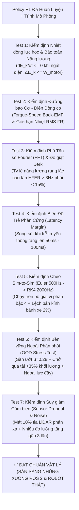

# PHẦN 4 (TẦNG 4): LÀM SAO CHỈ VỚI CODE ĐỂ BIẾT MÔ PHỎNG & THUẬT TOÁN RL THẬT SỰ HOẠT ĐỘNG ĐƯỢC NGOÀI ĐỜI THỰC?

> **Trả lời câu hỏi cốt lõi:**
> *"Khi chưa có robot thật trong tay (chỉ có máy tính và code), làm sao biết chắc chắn mô phỏng của mình có đúng vật lý không, và thuật toán RL vừa train xong khi nạp vào robot thật sẽ chạy mượt mà hay sẽ đâm tường / cháy motor?"*
>
> Trong công nghiệp Robotics hiện đại, trước khi cho phép nạp bất kỳ dòng code AI nào xuống phần cứng thật, kỹ sư phải chạy một **Bộ 7 Bài Kiểm Định Thực Tế Vật Lý Bằng Code (The 7-Point Physical Reality Verification Suite)**. Nếu một Policy vượt qua đủ 7 bài test này trên máy tính, xác suất chạy thành công ngay lần đầu tiên trên Robot thật (Zero-shot Sim-to-Real) đạt trên **85% – 95%**.

---

## Tổng quan 7 Bài Kiểm Định Thực Tế Bằng Code

---

## Giải thích Toán học & Vật lý của Từng Bài Kiểm Định

### Bài Kiểm định 1: Kiểm định Định luật Bảo toàn Năng lượng & Tính Thụ động (Energy & Passivity Audit)
- **Câu hỏi:** Làm sao biết **bản thân trình mô phỏng (Simulator)** không bị lỗi code tạo ra lực ma hoặc năng lượng ảo?
- **Cơ chế Toán học:**
  1. **Kiểm tra cân bằng công – năng lượng khi có tải:**
     Tổng công cơ học do các động cơ sinh ra trong khoảng $[0, T]$ là:
     $$W_{\text{motor}} = \sum_{k=0}^{K-1} \Big(\tau_{L, k}\,\omega_{L, k} + \tau_{R, k}\,\omega_{R, k}\Big)\Delta t$$
     Theo Định luật Bảo toàn Năng lượng, biến thiên động năng của robot $\Delta E_k = E_k(T) - E_k(0)$ cộng với năng lượng tiêu tán do ma sát $E_{\text{dissipated}} \ge 0$ phải bằng $W_{\text{motor}}$. Suy ra bất đẳng thức kiểm định bắt buộc:
     $$\Delta E_k \le W_{\text{motor}} + \epsilon_{\text{tol}}$$
  2. **Kiểm tra Trôi tự do khi Ngắt điện (Unforced Coast-down Passivity):**
     Cho robot đang chạy ở vận tốc $v_0 > 0$, sau đó ngắt hoàn toàn mô-men động cơ ($\tau_L = \tau_R = 0$). Động năng $E_k(t) = \frac{1}{2}mv(t)^2 + \frac{1}{2}I_{zz}\omega(t)^2$ bắt buộc phải là **hàm giảm đơn điệu nghiêm ngặt** ở mọi bước thời gian:
     $$E_k(t + \Delta t) \le E_k(t) \quad \forall t$$
     Nếu có bất kỳ bước nào $E_k(t + \Delta t) > E_k(t)$ $\implies$ Bộ tích phân số của Simulator đã bị lỗi tự bơm năng lượng!

---

### Bài Kiểm định 2: Kiểm định Đường bao Cơ – Điện & Nhiệt lượng Động cơ (Motor & Thermal Envelope)
- **Câu hỏi:** Policy có bắt động cơ làm việc vượt quá khả năng vật lý hoặc gây cháy cuộn dây đồng không?
- **Cơ chế Toán học:**
  Ngoài giới hạn mô-men tức thời $|\tau_i(t)| \le \tau_{\text{stall}}(1 - |\omega_i(t)|/\omega_{\text{no\_load}})$, động cơ điện ngoài đời thực còn bị giới hạn bởi **Nhiệt độ cuộn dây** thông qua **Mô-men xoắn hiệu dụng (RMS Torque)**:
  $$\tau_{\text{RMS}} = \sqrt{\frac{1}{T}\int_0^T \frac{\tau_L^2(t) + \tau_R^2(t)}{2}\,dt}$$
  - **Tiêu chuẩn Vật lý:** $\tau_{\text{RMS}}$ phải nhỏ hơn **Mô-men định mức liên tục ($\tau_{\text{continuous}} \approx 0.50 \times \tau_{\text{stall}}$)**. Nếu $\tau_{\text{RMS}}$ vượt ngưỡng này, robot chạy thử 30 giây thì tốt nhưng chạy 5 phút sẽ chảy nhựa vỏ motor!

---

### Bài Kiểm định 3: Phân tích Phổ Tần số Fourier (FFT) & Độ giật Cơ khí (Spectral Chattering & Jerk Audit)
- **Câu hỏi:** Làm sao phát hiện chỉ qua con số rằng Policy sẽ làm robot thật rung bần bật (Chattering)?
- **Cơ chế Toán học:**
  Lấy chuỗi tín hiệu điều khiển góc quay $u_\omega[0], u_\omega[1], \dots, u_\omega[N-1]$ (tần số lấy mẫu $f_s = 20\text{ Hz}$). Áp dụng **Biến đổi Fourier Rời rạc (DFT)**:
  $$U[k] = \sum_{n=0}^{N-1} u_\omega[n]\left[\cos\!\left(\frac{2\pi kn}{N}\right) - i\sin\!\left(\frac{2\pi kn}{N}\right)\right], \qquad f_k = \frac{k}{N}f_s$$
  Một con robot di động có quán tính cơ học lớn chỉ có thể đáp ứng mượt các lệnh chuyển hướng ở tần số thấp ($f \le 2.5\text{ Hz}$). Mọi thành phần tần số cao ($f \in (3\text{ Hz}, 10\text{ Hz}]$) đều là **nhiễu rung cơ học (Chattering)**.
  Ta định nghĩa **Tỷ số Năng lượng Rung Cao tần (High-Frequency Energy Ratio - HFER)**:
  $$\text{HFER} = \frac{\sum_{f_k > 3.0\text{ Hz}} |U[k]|^2}{\sum_{f_k > 0\text{ Hz}} |U[k]|^2} \times 100\%$$
  - **Tiêu chuẩn Vật lý:**
    - $\text{HFER} < 12\%$ và Độ giật trung bình $\mathbb{E}[\|\Delta \mathbf{a}\|^2] < 0.08$: **Đạt chuẩn êm ái công nghiệp (PASS)**.
    - $\text{HFER} > 20\%$: **Loại bỏ ngay lập tức (FAIL)** — Policy đang điều khiển kiểu Bang-Bang, chắc chắn phá hỏng hộp số ngoài đời thực!

---

### Bài Kiểm định 4: Kiểm định Biên Độ Trễ Phần Cứng (Hardware Latency Margin Test)
- **Câu hỏi:** Khi đưa lên ROS 2 và phần cứng thật, có độ trễ truyền tin qua USB/Wi-Fi/CAN bus, Policy có bị mất ổn định (quá đà rồi lắc lư) không?
- **Cơ chế:** Giữ nguyên Policy, tăng dần độ trễ phần cứng trong Simulator từ $\tau_d = 0\text{ ms} \to 50\text{ ms} \to 100\text{ ms} \to 150\text{ ms}$.
  - Policy tốt phải duy trì tỷ lệ thành công $\ge 75\%$ ngay cả khi độ trễ lên tới $100\text{ ms}$ (2 chu kỳ điều khiển).

---

### Bài Kiểm định 5: Kiểm định Chéo giữa 2 Bộ Giải Vật Lý (Sim-to-Sim Cross-Validation)
- **Câu hỏi:** Nếu không có robot thật, cái gì đóng vai trò thay thế cho "Thế giới thực" để sát hạch Policy?
- **Cơ chế:** Dùng kỹ thuật **Sim-to-Sim Verification**:
  - Policy được huấn luyện trên **Simulator A (Fast Training Sim):** Tích phân Symplectic Euler, bước thời gian $\Delta t = 2\text{ ms}$, hai bánh xe hoàn hảo đối xứng.
  - Đem kiểm định trên **Simulator B (High-Precision Reference Sim):**
    1. Đổi bộ giải vi phân sang **Runge-Kutta bậc 4 (RK4)** với bước thời gian siêu mịn $\Delta t = 0.5\text{ ms}$ ($2000\text{ Hz}$).
    2. Cố tình làm **lệch bán kính bánh xe trái/phải $2\%$** ($r_L = 1.01 r_0, r_R = 0.99 r_0$ — mô phỏng lốp mòn không đều khiến xe luôn có xu hướng tự lệch sang phải).
    3. Thêm nhiễu lực cản gió ngẫu nhiên ở mỗi bước.
  - Nếu Policy vượt qua Simulator B mà không cần train lại $\implies$ Policy thực sự có khả năng khép kín vòng lặp phản hồi (Closed-loop feedback robustness) như ngoài đời thực!

---

### Bài Kiểm định 6 & 7: Kiểm định Bền vững Ngoài Phân phối (OOD) & Suy giảm Cảm biến
- **Test 6 (OOD Physical Stress):** Cho robot nặng thêm $+30\%$ ($m = 2.83\text{ kg}$) chạy trên mặt sàn trơn ướt ($\mu_{\text{static}} = 0.28$) và bị một cú huých ngang bất ngờ giữa đường.
- **Test 7 (Sensor Degradation):** Tăng nhiễu LiDAR lên $\sigma = 3\text{ cm}$ và làm rớt ngẫu nhiên $10\%$ số tia laser (`dropout = 0.10`).

---

## Mã nguồn Thực thi: `04_physical_reality_verification_suite.py`

Chạy trực tiếp [04_physical_reality_verification_suite.py](file:///home/thinh/Reinforcement-Learning/Sim2Real_Robotics/code/04_physical_reality_verification_suite.py) để xem bảng đối chiếu 7 bài test giữa `Naive_Toy_Policy` và `Sim2Real_Robust_Policy`.

🔗 **Tiếp theo:** Sau khi `Sim2Real_Robust_Policy` vượt qua toàn bộ 7 bài kiểm định, hãy chuyển sang [Phần 5: Kết nối sang Node ROS 2, Gazebo & Robot thật](file:///home/thinh/Reinforcement-Learning/Sim2Real_Robotics/Part5_ROS2_Gazebo_And_Real_Robot_Bridge.md).
