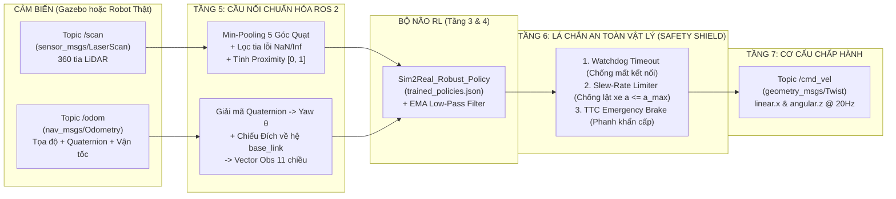

# PHẦN 5 (TẦNG 5 – 6 – 7): KẾT NỐI TỪ SIMULATION TRAINING SANG ROS 2, GAZEBO VÀ ROBOT THẬT

> **Mục tiêu của Phần 5:**
> Sau khi đã huấn luyện xong `Sim2Real_Robust_Policy` ở **Tầng 3** và chứng minh nó vượt qua toàn bộ 7 bài kiểm định vật lý ở **Tầng 4**, làm thế nào để nhúng bộ não AI này vào hệ thống **ROS 2** để điều khiển robot **Andino** trong **Gazebo** (thuộc khoá học `robotics_essentials_ros2` của bạn) cũng như nạp thẳng xuống **Robot vật lý ngoài đời thực**?

---

## 1. Kiến trúc Kết nối 3 Tầng Triển khai (Tầng 5 $\to$ Tầng 6 $\to$ Tầng 7)



---

## 2. Tầng 5: Toán học Chuyển đổi Gói tin ROS 2 sang Vector Quan sát của Mạng RL

Trong mô phỏng RL (Tầng 3), mạng nơ-ron nhận một mảng 11 số thực sạch sẽ. Nhưng trong ROS 2 (và trên robot thật), dữ liệu đến từ các gói tin bất đồng bộ (Asynchronous Topics):

### 2.1. Giải mã Góc Hướng (Yaw $\theta$) từ Quaternion của `/odom`
Gói tin `nav_msgs/msg/Odometry` lưu hướng của robot dưới dạng **Quaternion 4 chiều** $\mathbf{q} = (x, y, z, w)$ để tránh lỗi khóa khớp (Gimbal Lock). Để chuyển về góc quay phẳng $\theta$ (Yaw quanh trục $Z$) khớp với Tầng 2 & Tầng 3, ta dùng công thức lượng giác chính xác:
$$\theta = \operatorname{atan2}\Big(2.0 \cdot (w \cdot z + x \cdot y),\; 1.0 - 2.0 \cdot (y^2 + z^2)\Big) \in [-\pi, \pi]$$

### 2.2. Kỹ thuật Gộp Cửa sổ Cực tiểu (Sector Min-Pooling) cho Cảm biến LiDAR `/scan`
Cảm biến LiDAR thực tế trên robot Andino (`rplidar`) phát ra mảng `msg.ranges` gồm $360$ đến $720$ tia laser, trong đó có nhiều tia mang giá trị `inf` (xa quá tầm đo) hoặc `nan` (nhiễu phản xạ).
Để nén $360$ tia về $5$ hướng quan sát (`front`, `front_left`, `front_right`, `left`, `right`) của mạng nơ-ron:

> ⚠️ **Quy tắc sống còn:** Phải lấy **Giá trị Nhỏ nhất (`min`)** trong mỗi góc quạt chứ **TUYỆT ĐỐI KHÔNG lấy Trung bình cộng (`mean`)**!
> - **Lý do vật lý:** Giả sử trước mặt robot có một chiếc chân ghế sắt mảnh (chiếm 2 tia laser ở khoảng cách $0.25\text{ m}$), còn 28 tia bên cạnh nhìn thấy bức tường ở xa $3.0\text{ m}$. Nếu lấy `mean`, khoảng cách trung bình là $2.81\text{ m}$ — mạng nơ-ron tưởng phía trước trống trải và phóng thẳng đâm gãy chân ghế! Ngược lại, phép lấy `min` báo chính xác $0.25\text{ m}$, kích hoạt phản xạ né vật cản ngay lập tức.

$$d_{\text{sector}} = \min_{\substack{\beta_i \in [\beta_{\min}, \beta_{\max}] \\ d_{\min} < r_i < d_{\max}}} r_i, \qquad \text{prox}_{\text{sector}} = \operatorname{clip}\!\left(1.0 - \frac{d_{\text{sector}}}{d_{\max}},\; 0.0,\; 1.0\right)$$

---

## 3. Tầng 6: Lá chắn An toàn Vật lý (Control Barrier / Hardware Safety Shield)

Khi triển khai AI lên robot thật, mọi hệ thống công nghiệp (xe tự hành Waymo, robot Boston Dynamics, drone tự hành) đều có một **Tầng Lá chắn An toàn Độc lập (Safety Shield)** bọc bên ngoài mạng nơ-ron. Dù mạng nơ-ron có bị lỗi gì, Tầng 6 cũng không cho phép robot gây tai nạn:

1. **Bộ canh cổng Thời gian (Sensor Watchdog Timer):**
   Kiểm tra tuổi của gói tin cảm biến: $\Delta t_{\text{sensor}} = t_{\text{now}} - t_{\text{last\_scan}}$. Nếu $\Delta t_{\text{sensor}} > 0.25\text{ s}$ (dây cáp LiDAR bị lỏng hoặc node cảm biến bị treo), lập tức ghi đè lệnh dừng khẩn cấp $(v = 0, \omega = 0)$.
2. **Giới hạn Gia tốc Chống lật & Bảo vệ Cầu H (Slew-Rate Acceleration Limiter):**
   Ở **Tầng 1** (`01_urdf_physics_inspector.py`), ta đã chứng minh gia tốc chống lật tối đa của robot Andino là $a_{\text{tip\_over}} = 5.67\text{ m/s}^2$. Tầng 6 giới hạn gia tốc cho phép ở ngưỡng an toàn $a_{\text{safe}} = 1.5\text{ m/s}^2$:
   $$v_{\text{safe}}(t) = \operatorname{clip}\Big(v_{\text{policy}}(t),\; v(t-\Delta t) - a_{\text{safe}}\Delta t,\; v(t-\Delta t) + a_{\text{safe}}\Delta t\Big)$$
3. **Phanh Khẩn cấp Thời gian Va chạm (Time-To-Collision / TTC Reflex):**
   Nếu khoảng cách vật cản chính diện $d_{\text{front}} \le d_{\text{emergency}} = 0.22\text{ m}$ mà Policy vẫn đòi tiến tới ($v > 0$), Tầng 6 tự động cắt $v_{\text{safe}} = 0.0\text{ m/s}$ và chỉ giữ lại vận tốc xoay $\omega$ để robot quay mũi thoát ra.

---

## 4. Tầng 7: Hướng dẫn Tích hợp Chạy Trực tiếp với Gazebo (`robotics_essentials_ros2`) và Robot Thật

### Điểm kỳ diệu của Kiến trúc Phân tầng ROS 2:
Nhờ toàn bộ giao tiếp ở Tầng 5–6–7 đều chuẩn hóa qua 3 ROS 2 Topics (`/scan`, `/odom`, `/cmd_vel`), **file code `05_ros2_rl_deployment_node.py` chạy được ở cả 3 chế độ mà không cần sửa bất kỳ dòng code nào**:

```
┌─────────────────────────────────────────────────────────────────────────┐
│             05_ros2_rl_deployment_node.py + trained_policies.json       │
└───────────────────┬───────────────────────────────┬─────────────────────┘
                    │                               │
       Chế độ 1: Trong Gazebo Sim          Chế độ 2: Trên Robot Andino Thật
       (Qua cầu nối ros_gz_bridge)         (Qua driver phần cứng andino_base)
                    ▼                               ▼
     ┌──────────────────────────────┐ ┌──────────────────────────────┐
     │ ros2 launch andino_gz        │ │ ros2 launch andino_bringup   │
     │   andino_gz.launch.py        │ │   andino_robot.launch.py     │
     └──────────────────────────────┘ └──────────────────────────────┘
```

### 🚀 Cách 1: Chạy Kiểm thử Độc lập Ngay Trên Máy Tính (Không cần bật Docker/Gazebo)
File [05_ros2_rl_deployment_node.py](file:///home/thinh/Reinforcement-Learning/Sim2Real_Robotics/code/05_ros2_rl_deployment_node.py) đã tích hợp sẵn bộ giả lập luồng bản tin ROS 2 (`LaserScan`, `Odometry`, `Twist`). Bạn có thể chạy ngay lập tức bằng lệnh:
```bash
python3 Sim2Real_Robotics/code/05_ros2_rl_deployment_node.py --standalone-test
```

### 🚀 Cách 2: Chạy Trực tiếp Cùng Robot Andino 3D Trong Gazebo (`robotics_essentials_ros2`)
Bạn có thể copy thẳng file node này vào thư mục chia sẻ `/home/thinh/exercises_ws/src` của Docker container:

```bash
# Bước 1: Copy code triển khai RL và file trọng số sang workspace ROS 2 được mount với Docker
cp Sim2Real_Robotics/code/05_ros2_rl_deployment_node.py ~/exercises_ws/src/
cp Sim2Real_Robotics/code/trained_policies.json ~/exercises_ws/src/

# Bước 2: Mở 1 terminal trong Docker để bật Gazebo mô phỏng Robot Andino
docker exec -it robotics_essentials_ros2 bash
ros2 launch andino_gz andino_gz.launch.py

# Bước 3: Mở terminal thứ 2 trong Docker và chạy trực tiếp Node điều khiển RL
docker exec -it robotics_essentials_ros2 bash
python3 /home/user/exercises_ws/src/05_ros2_rl_deployment_node.py --goal-x 2.0 --goal-y 0.5
```
*(Nhớ bấm nút **Play (▶)** ở góc dưới bên trái cửa sổ Gazebo để thế giới vật lý bắt đầu chạy!)*
