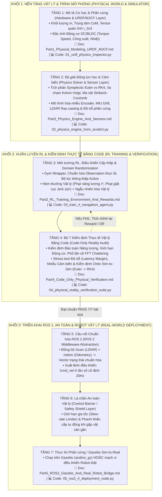

# KIẾN TRÚC PHÂN TẦNG SIM-TO-REAL: TỪ MÔ PHỎNG VẬT LÝ, HUẤN LUYỆN RL ĐẾN KIỂM ĐỊNH VÀ TRIỂN KHAI ROBOT THỰC TẾ

> **Mục tiêu của Module `Sim2Real_Robotics`:**
> Bộ tài liệu và mã nguồn thực thi này giải quyết trọn vẹn 3 câu hỏi cốt lõi của kỹ sư Robotics & AI:
> 1. **Phân tầng chi tiết:** Hệ thống mô phỏng và điều khiển robot gồm những tầng nào, mỗi tầng giải quyết bài toán vật lý và toán học gì?
> 2. **Kiểm định thực tế chỉ bằng Code (Code-Only Physical Verification):** Khi chưa có robot thật trong tay, làm sao dùng code để chứng minh mô phỏng có tuân thủ định luật vật lý không và thuật toán RL có chạy sống sót được ngoài đời thực không?
> 3. **Kết nối Sim Training $\to$ Thực tế (Sim-to-Real Pipeline):** Làm sao nối mạch liền lạc từ lúc huấn luyện RL trong Simulator sang hệ điều hành **ROS 2 / Gazebo** và nạp thẳng xuống **Robot vật lý**?

---

## 🏗️ Sơ đồ Kiến trúc Phân tầng 7 Lớp (The 7-Layer Sim-to-Real Architecture)

Toàn bộ hệ thống được chia thành **7 tầng độc lập nhưng kết nối chặt chẽ** theo đúng chuẩn công nghiệp hiện đại:



---

## 📂 Danh mục Tài liệu & Mã nguồn Minh họa (Theo từng phần nhỏ)

Mỗi phần dưới đây đều gồm **1 file Lý thuyết & Giải thích Toán-Lý chi tiết (`.md`)** đi kèm **1 file Code Python thực thi độc lập (`.py`)**:

| Phần | Tài liệu Giải thích Chi tiết (`.md`) | Mã nguồn Thực thi Minh họa (`.py`) | Nội dung & Mục đích cốt lõi |
| :--- | :--- | :--- | :--- |
| **Phần 1** | [Part1_Physical_Modeling_URDF_MJCF.md](file:///home/thinh/Reinforcement-Learning/Sim2Real_Robotics/Part1_Physical_Modeling_URDF_MJCF.md) | [01_urdf_physics_inspector.py](file:///home/thinh/Reinforcement-Learning/Sim2Real_Robotics/code/01_urdf_physics_inspector.py) | **Tầng 1:** Giải thích cấu trúc hình học $SE(3)$, khối lượng, ma trận quán tính $\mathbf{I}$, bất đẳng thức tam giác vật lý $I_{xx}+I_{yy}\ge I_{zz}$, đa giác chân đế chống lật và đặc tính động cơ DC. Code tự động quét và bắt lỗi cấu hình vật lý của robot. |
| **Phần 2** | [Part2_Physics_Engine_And_Sensors.md](file:///home/thinh/Reinforcement-Learning/Sim2Real_Robotics/Part2_Physics_Engine_And_Sensors.md) | [02_physics_engine_from_scratch.py](file:///home/thinh/Reinforcement-Learning/Sim2Real_Robotics/code/02_physics_engine_from_scratch.py) | **Tầng 2:** Xây dựng bộ giải vật lý từ gốc (Symplectic Euler vs RK4), mô hình ma sát Stribeck-Coulomb, giới hạn bão hòa motor, độ trễ phần cứng và nhiễu cảm biến (Encoder, IMU, LiDAR). |
| **Phần 3** | [Part3_RL_Training_Environment_And_Rewards.md](file:///home/thinh/Reinforcement-Learning/Sim2Real_Robotics/Part3_RL_Training_Environment_And_Rewards.md) | [03_train_rl_navigation_agent.py](file:///home/thinh/Reinforcement-Learning/Sim2Real_Robotics/code/03_train_rl_navigation_agent.py) | **Tầng 3:** Đóng gói Simulator thành môi trường RL chuẩn, thiết kế hàm thưởng vật lý (chống giật cục cơ khí, tiết kiệm điện năng), tích hợp Domain Randomization và huấn luyện Policy điều hướng robot Andino. |
| **Phần 4** | [Part4_Code_Only_Physical_Verification.md](file:///home/thinh/Reinforcement-Learning/Sim2Real_Robotics/Part4_Code_Only_Physical_Verification.md) | [04_physical_reality_verification_suite.py](file:///home/thinh/Reinforcement-Learning/Sim2Real_Robotics/code/04_physical_reality_verification_suite.py) | **Tầng 4:** **7 Bài kiểm định thực tế chỉ bằng code**: Kiểm tra bảo toàn năng lượng, đường bao công suất motor, phân tích phổ FFT chống rung khớp, kiểm tra biên độ trễ (Latency Margin) và kiểm định chéo **Sim-to-Sim** (Euler $\to$ RK4). |
| **Phần 5** | [Part5_ROS2_Gazebo_And_Real_Robot_Bridge.md](file:///home/thinh/Reinforcement-Learning/Sim2Real_Robotics/Part5_ROS2_Gazebo_And_Real_Robot_Bridge.md) | [05_ros2_rl_deployment_node.py](file:///home/thinh/Reinforcement-Learning/Sim2Real_Robotics/code/05_ros2_rl_deployment_node.py) | **Tầng 5, 6, 7:** Kết nối Policy đã huấn luyện vào **ROS 2 Node** (`/scan`, `/odom` $\to$ Policy $\to$ Safety Shield $\to$ `/cmd_vel`) để chạy trực tiếp trong **Gazebo (`robotics_essentials_ros2`)** hoặc trên **Robot thật**. |

---

## 🚀 Hướng dẫn Chạy Nhanh Toàn bộ Chuỗi Thực nghiệm (End-to-End Execution)

Bạn có thể chạy lần lượt 5 kịch bản code minh họa ngay trên terminal để chứng kiến toàn bộ quy trình từ kiểm tra thông số vật lý $\to$ mô phỏng động lực học $\to$ huấn luyện RL $\to$ kiểm định chất lượng vật lý $\to$ triển khai ROS 2:

```bash
# Bước 1: Kiểm tra tính hợp lệ vật lý của cấu hình Robot (URDF/Inertial/Actuator Audit)
python3 Sim2Real_Robotics/code/01_urdf_physics_inspector.py

# Bước 2: Chạy thử nghiệm so sánh Mô phỏng Lý tưởng vs. Mô phỏng Vật lý Thực tế (RK4 + Friction + Latency)
python3 Sim2Real_Robotics/code/02_physics_engine_from_scratch.py

# Bước 3: Huấn luyện RL Policy với Domain Randomization & Physics-Aware Reward
python3 Sim2Real_Robotics/code/03_train_rl_navigation_agent.py

# Bước 4: Chạy Bộ 7 Bài Kiểm định Thực tế Vật lý (Code-Only Physical Reality Verification)
python3 Sim2Real_Robotics/code/04_physical_reality_verification_suite.py

# Bước 5: Chạy thử nghiệm Node triển khai ROS 2 (kèm Lá chắn An toàn Vật lý)
python3 Sim2Real_Robotics/code/05_ros2_rl_deployment_node.py --standalone-test
```
